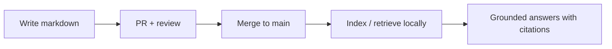

# TeamKM

**Your team’s memory, in git—searchable on your machine.**

**Documentation (all roles):** [TeamKM docs site](https://gyaneshgithub.github.io/TeamKM/) — engineering, management, product, quality, and reference.

TeamKM is a **template repo** for durable engineering knowledge: Markdown lives under `knowledge/` with validated YAML front matter, merges happen through **PRs**, and a **local** retrieval pipeline turns that corpus into **grounded context** for agents and humans (hybrid search, mandatory rerank, HTTP API on loopback). Normative behaviour: [docs/REQUIREMENTS.md](docs/REQUIREMENTS.md).

**New here?** Start with **[How to use TeamKM](docs/HOW_TO_USE_TEAMKM.md)** — short, structured guide for **everyone** (including non-developers).

---

## Why this exists

- **Chat doesn’t compound.** Decisions and gotchas that live only in threads don’t survive rotation, releases, or six months of new hires.
- **Wikis drift.** Without the same review and history model as code, “the doc” and “the system” quietly diverge.
- **Assistants need anchors.** Models answer from patterns in training data unless you **retrieve** what *your* repo already says—then answers can be **cited** and checked.

This project makes **merged markdown** the product: diffable, reviewable, and the input to a **local RAG** you control.

---

## For engineering leads (rolling this out)

Use this repo as a **template**: your team owns **their** remote and **their** corpus under `knowledge/`.

1. **Skim the business case** — [docs/LEADERSHIP_PITCH.md](docs/LEADERSHIP_PITCH.md) (outcomes, risks, assistant-agnostic integration).
2. **Create the team repo** — GitHub “Use this template” / fork / clone, then set **`origin`** to **your** org repo so merges and branch protection apply to you ([REQUIREMENTS §4.5](docs/REQUIREMENTS.md)).
3. **Lock down `main`** — PR-only workflow, required check **`test`**, at least one reviewer ([CONTRIBUTING.md](CONTRIBUTING.md), [docs/GITHUB_BRANCH_PROTECTION.md](docs/GITHUB_BRANCH_PROTECTION.md)).
4. **Start small** — One **pilot area** (e.g. one service or feature); agree who writes **technical** vs **QE** vs **PM** notes ([REQUIREMENTS §2–§3](docs/REQUIREMENTS.md)).
5. **Make it habitual** — Tie knowledge updates to **definition of done** (short PRs to `knowledge/` alongside code when it matters).
6. **Optional: measure** — Golden-query recall and corpus growth are sketched in [REQUIREMENTS §11](docs/REQUIREMENTS.md); tune once you have real volume.

Developers follow **Quick start** below; leadership mainly sets **policy, ownership, and merge discipline**—the same habits that make any inner-source repo work.

---

## What you get (at a glance)

| Piece | What it does |
|-------|----------------|
| **`knowledge/`** | The corpus—technical, delivery, testing, functional, meta—with §6.1 front matter. |
| **`ki`** | Validate, index, serve: chunk → hybrid retrieve → rerank → context packs. |
| **HTTP API** | `127.0.0.1` by default—any tool that speaks HTTP (or MCP downstream) can plug in. |
| **MCP (optional)** | `pip install -e ".[mcp]"` then `python3 -m ki mcp` — tools **`teamkm_*`** call the same API; the **IDE host** runs the agent loop (retrieve-first policy). |
| **CI** | Tests, front matter checks, golden queries—see [docs/TESTING.md](docs/TESTING.md). |

After you merge to `main`, optional automation can promote **`draft` → `reviewed`** for touched docs (see [CONTRIBUTING.md](CONTRIBUTING.md)).

---

## The loop (conceptually)



---

## Documentation map

| Doc | Read it for… |
|-----|----------------|
| [docs/HOW_TO_USE_TEAMKM.md](docs/HOW_TO_USE_TEAMKM.md) | **Start here:** simple flow for the whole team (writers, reviewers, leads). |
| [docs/REQUIREMENTS.md](docs/REQUIREMENTS.md) | Full product spec (normative). |
| [docs/ARCHITECTURE.md](docs/ARCHITECTURE.md) | How indexing and retrieval fit together. |
| [docs/LEADERSHIP_PITCH.md](docs/LEADERSHIP_PITCH.md) | Short executive / leadership brief. |
| [docs/TESTING.md](docs/TESTING.md) | Tests, golden queries, safety rails. |
| [docs/MCP.md](docs/MCP.md) | Optional MCP stdio server (`ki mcp`), tools, env vars. |
| [CONTRIBUTING.md](CONTRIBUTING.md) | Branches, PRs, corpus rules, draft promotion. |
| `.cursor/skills/teamkm-*` | Agent skills: retrieve-first, run local, MCP, pre-PR; **no-secrets**, **onboard**, **golden-query-tuning**, **share-project**. |
| [docs/GITHUB_BRANCH_PROTECTION.md](docs/GITHUB_BRANCH_PROTECTION.md) | Protecting `main` on GitHub. |

---

## Quick start (tooling)

**Python 3.10+.**

```bash
cd /path/to/TeamKM
python3 -m venv .venv
source .venv/bin/activate   # Windows: .venv\Scripts\activate
pip install -e ".[dev]"
# Optional: MCP adapter for IDEs — pip install -e ".[dev,mcp]"
pytest
python3 scripts/validate_frontmatter.py --root .
python3 -m ki index --root .
python3 -m ki serve --root . --host 127.0.0.1 --port 8765
```

**Before opening a PR**, see whether your idea overlaps existing docs (merge vs new):

```bash
python3 -m ki contribute --root . -f path/to/draft.md
```

**Another terminal**—sanity-check the API:

```bash
curl -s http://127.0.0.1:8765/v1/health | python3 -m json.tool
curl -s http://127.0.0.1:8765/v1/retrieve -H 'Content-Type: application/json' \
  -d '{"query":"your topic","candidate_k":24,"pack_k":12}' | python3 -m json.tool
```

**Validator flags:** `--inject-domain` if `domain` is omitted (canonical from path); `--fix` to write `domain` atomically after other checks pass.

**Session wrapper** (REQUIREMENTS §12.1, pattern B): [scripts/ki-session.sh](scripts/ki-session.sh) starts `ki serve` then runs your assistant.

**Retrieval stack (implemented):** tf‑idf cosine **+** BM25, **RRF** fusion, then **mandatory rerank** (`ki/retrieve.py`). **OpenAPI:** [docs/openapi.yaml](docs/openapi.yaml) — with `ki serve`, **`GET /openapi.yaml`** or **`GET /openapi.json`**. **Golden queries:** [meta/golden_queries.yaml](meta/golden_queries.yaml) — run `python3 scripts/golden_queries.py --root .`

**Agents (recommended pattern):** run **`python3 -m ki serve`** in the repo, then point your MCP host at **`python3 -m ki mcp`** (install **`.[mcp]`**). Set **`TEAMKM_API_BASE`** if the API is not `http://127.0.0.1:8765`. Tools: **`teamkm_health`**, **`teamkm_retrieve`**, **`teamkm_context_pack`**, **`teamkm_contribute_dry_run`**; prompt **`teamkm_retrieve_first`** encodes retrieve-before-edit policy.

---

## Repo layout

| Path | Role |
|------|------|
| `knowledge/` | Corpus (Markdown + YAML front matter) |
| `ki/` | Python package: validators, indexer, local API |
| `scripts/` | Helpers (validate, golden queries, promote-on-merge, etc.) |
| `.rag/` | Generated index and manifest (**gitignored**) |

---

## License

Add a license file when you adopt this template for your org.
