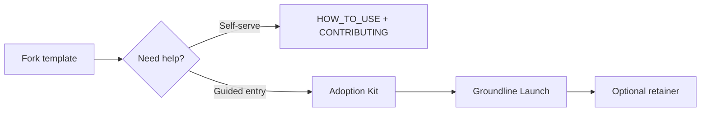

# Adopting Groundline

**Groundline** is an **open template**: the engine, docs, and skills are **free** to fork and run. Many teams also want **help rolling out** habits—repository setup, workshops, seed corpus, and agent integration. That help is delivered as **professional services** (fixed projects or retainers), not as locked features in the software.

**This page describes what adoption looks like.** It does **not** include pricing or commercial terms.

---

## Free (self-serve)

You get everything needed to run Groundline on your own:

| Capability | Where |
|------------|--------|
| Template repo, `ki` CLI, local index & API | [README](../README.md) quick start |
| Corpus rules, PR workflow | [Contributing](contributing.md) |
| Role guides & reference | [Documentation home](index.md) |
| MCP & retrieve-first | [MCP.md](MCP.md) |
| Brand vs technical ids | [BRAND.md](BRAND.md) |

**Your team owns** `knowledge/`, your git remote, and your index on developer machines.

---

## Paid offerings (services — optional)

Paid tiers are **delivery and enablement**, not a paywalled engine. Typical packages:

| Offering | Best for | Outcomes (summary) |
|----------|----------|-------------------|
| **Adoption Kit** (~2 weeks) | First-time rollout in one team | Protected `main`, two workshops, pilot area, DoD for knowledge PRs, golden-query intro |
| **Groundline Launch** (4–6 weeks) | Full pilot with agent integration | Seed corpus (tech + QE + product), golden queries in CI, MCP for one squad, handoff runbook |
| **Integration sprint** | IDE/MCP wiring | Retrieve-first in Cursor or compatible host; squad guide |
| **Managed corpus review** | Ongoing quality | Monthly corpus health and retrieval-regression narrative |
| **Training** | Many writers at once | Context engineering for teams (authoring, PR gates, retrieve-first) |
| **Annual engine support** | Long-lived fork | Scheduled merges from template; advisory |

Commercial scope, workshops, and reports are agreed in a **statement of work** per client. Contact your Groundline provider for proposals.

---

## Recommended path

1. **Fork** — [REQUIREMENTS §4.5](REQUIREMENTS.md#45-adopting-this-repository-as-a-team-template)  
2. **Protect `main`** — [Branch protection](GITHUB_BRANCH_PROTECTION.md)  
3. **Pilot one area** — single service or feature  
4. **Optional services** — Adoption Kit first, then Launch if you want full corpus + MCP handoff  

---

## Pilot in about two weeks (self-serve minimum)

| Week | Activity |
|------|----------|
| 1 | Repo + protection; reviewers; one draft in `knowledge/` |
| 2 | First PR merged; optional `ki index` on one machine |

With **Adoption Kit**, the same window adds facilitated workshops and a signed rollout checklist.

---

## Multi-team / line of business

Each LoB should use **its own clone and remote** ([REQUIREMENTS §4.6](REQUIREMENTS.md)). The open template is reused; **corpus and governance stay owned** per team.

---

## What we do not sell in v1

- Hosted multi-tenant SaaS for your corpus  
- Replacement for Jira, Confluence, or ticket systems  
- License keys inside `ki` to block local retrieval  

---

## For leadership

Business case and risks: [Leadership brief](LEADERSHIP_PITCH.md).  
For management rollout: [For management](for-management.md).
