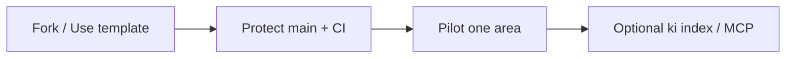

# Adopting Groundline

**Groundline** is an **open-source template** (MIT). Fork it, point `origin` at your org, and run the engine locally. Everything in this guide is **self-serve**—no commercial tier required.

---

## What you get for free

| Capability | Where |
|------------|--------|
| Template repo, `ki` CLI, local index & API | [README](../README.md) quick start |
| Corpus rules, PR workflow | [Contributing](contributing.md) |
| Role guides & reference | [Documentation home](index.md) |
| MCP & retrieve-first | [MCP.md](MCP.md) |
| Brand vs technical ids | [BRAND.md](BRAND.md) |

**Your team owns** `knowledge/`, your git remote, and your index on developer machines.

---

## Recommended path

1. **Fork** — [REQUIREMENTS §4.5](REQUIREMENTS.md#45-adopting-this-repository-as-a-team-template)  
2. **Protect `main`** — [Branch protection](GITHUB_BRANCH_PROTECTION.md)  
3. **Pilot one area** — single service or feature  
4. **Grow habit** — [HOW_TO_USE_GROUNDLINE](HOW_TO_USE_GROUNDLINE.md) for writers; [For engineering](for-engineering.md) for tooling  

---

## Pilot in about two weeks

| Week | Activity |
|------|----------|
| 1 | Repo + protection; reviewers; one draft in `knowledge/` |
| 2 | First PR merged; optional `ki index` on one machine |

---

## Multi-team / line of business

Each LoB should use **its own clone and remote** ([REQUIREMENTS §4.6](REQUIREMENTS.md)). Reuse the template; **corpus and governance stay owned** per team.

---

## For leadership

Business case: [Leadership brief](LEADERSHIP_PITCH.md).  
Rollout checklist: [For management](for-management.md).
