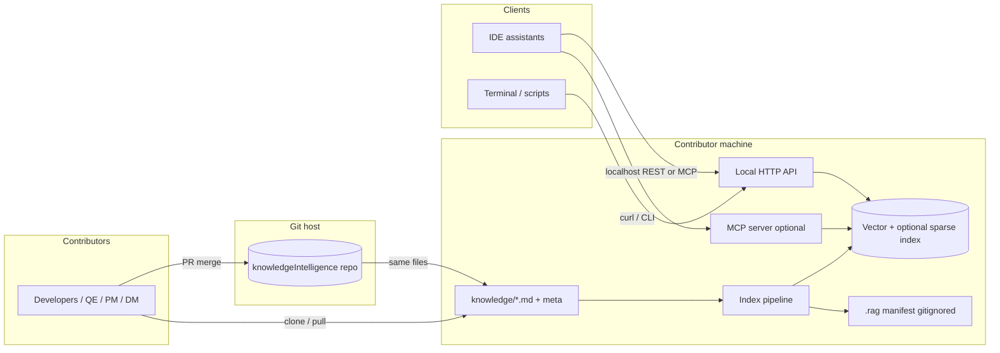
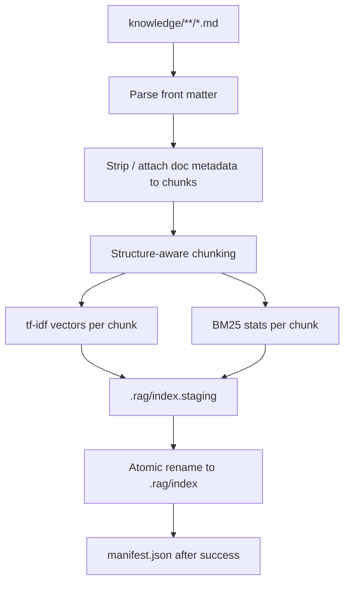
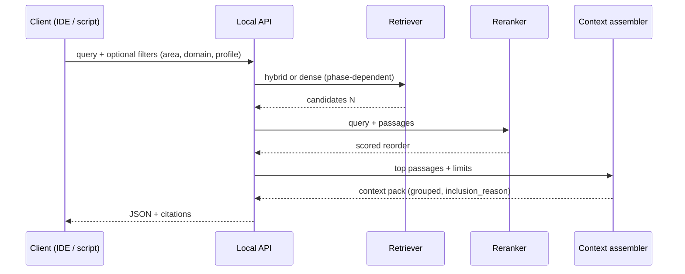

# knowledgeIntelligence — Architecture

**Status:** Draft (aligned with [REQUIREMENTS.md](REQUIREMENTS.md))  
**Owner:** GYANESH  
**Last updated:** 2025-11-06  

This document describes the **logical and physical architecture** of **knowledgeIntelligence**: a **git-hosted** corpus of Markdown, a **local** RAG index and services, and **assistant-agnostic** clients (HTTP, MCP, CLI). Normative behaviour, schemas, and phases remain in **REQUIREMENTS**; this file is the **systems view** for implementers and reviewers.

---

## 1. Goals and constraints

| Goal | How the architecture supports it |
|------|----------------------------------|
| **Single source of truth** | Markdown + YAML front matter in git; PR merges only ([REQUIREMENTS §4](REQUIREMENTS.md)). |
| **Compounding knowledge** | Full corpus at a commit SHA drives the index; each merge extends coverage ([§1, §3](REQUIREMENTS.md)). |
| **Grounded agent use** | Retrieve → mandatory rerank → context packs → **citations** on any generation path ([§5.5–§5.7, §5.10](REQUIREMENTS.md)). |
| **No vendor lock-in** | Canonical **REST + JSON** on loopback; optional **MCP** mirroring the same operations ([§5.9, §5.12](REQUIREMENTS.md)). |
| **Local-first** | Index and models run on the developer machine by default; optional CI validates corpus ([§5.2, §7–§8, §12](REQUIREMENTS.md)). |

**Non-goals for architecture v1:** Mandatory cloud embedding, proprietary-only IDE APIs, or storing work-tracker exports in the corpus ([§3](REQUIREMENTS.md)).

---

## 2. System context (C4-style)



**Responsibility split:**

- **Git remote:** Version history, review, branch protection — not the runtime for retrieval.
- **Local runtime:** Build index from working tree or pinned commit, serve queries with **health** (`index_status`, `sync_status`) ([§5.6, §12.1–§12.2](REQUIREMENTS.md)).

---

## 3. Repository layout (information architecture)

High-level map ([§6](REQUIREMENTS.md)):

```
knowledge/
  technical/      # architecture, runbooks, ADRs
  delivery/       # curated delivery summaries, analysis
  testing/        # QE-led quality knowledge
  functional/     # product / glossary / features
  meta/           # golden queries, policies, templates (paths may vary)
scripts/          # indexer, API server, validators (when implemented)
meta/             # contribution templates, author-profile.example.yaml, etc.
.rag/             # generated index + manifest (gitignored)
```

**Front matter** carries `title`, `area`, `type`, `status`, `author_role`, and **`domain`** derived from path or validated against it ([§6.1 Domain inference](REQUIREMENTS.md)).

---

## 4. Logical components

| Component | Responsibility |
|-----------|----------------|
| **Corpus** | Authoritative Markdown under `knowledge/`; evolves by PR. |
| **Ingest** | Discover files, parse front matter, normalize body. |
| **Chunker** | Structure-aware splits; stable chunk ids; metadata propagation ([§5.4](REQUIREMENTS.md)). |
| **Embedder (MVP)** | **tf‑idf** word vectors per chunk (dense surrogate until neural embeddings); model id in manifest. |
| **Sparse index (MVP)** | **Okapi BM25** over chunk term frequencies — **hybrid** with dense, fused via **RRF** ([§5.5, §5.11](REQUIREMENTS.md)). |
| **Retriever** | First stage: hybrid RRF → candidate set (e.g. top 20–40). |
| **Reranker** | **Mandatory** second stage; local cross-encoder or light ranker ([§5.5](REQUIREMENTS.md)). |
| **Context assembler** | Caps per doc, `related:` expansion, `inclusion_reason`, optional diversification ([§5.10](REQUIREMENTS.md)). |
| **API** | REST JSON: `retrieve`, `context_pack`, `health`, optional `get_chunk` / neighbours ([§5.6](REQUIREMENTS.md)). |
| **MCP adapter** | Same semantics as HTTP; namespaced tools (e.g. `kb_*`) ([§5.9](REQUIREMENTS.md)). |
| **Validator** | `scripts/validate_frontmatter.py`: schema + path/domain rules ([§6.1, §8](REQUIREMENTS.md)). |
| **Sync (optional)** | Fetch + fast-forward only when safe; feeds staleness for reindex ([§12.2](REQUIREMENTS.md)). |

---

## 5. Index build data flow



**Incremental build:** Content-hash per file; re-chunk/re-embed only changed files ([§5.5](REQUIREMENTS.md)). **Fingerprint:** Align index staleness with `git` tree / hashes ([§12.1](REQUIREMENTS.md)).

---

## 6. Query / context-pack data flow



**Contract:** Responses expose paths, line ranges, retrieval and rerank scores where applicable ([§5.6](REQUIREMENTS.md)). Downstream **generation** must cite chunks or mark gaps ([§5.7](REQUIREMENTS.md)).

---

## 7. Contribution flow (retrieval-first)

Designed so agents **do not** invent duplicates blindly ([§5.8](REQUIREMENTS.md)):

1. Refresh index to merge base.
2. **Retrieve** similar chunks for draft outline or title.
3. Present top‑k with scores and paths.
4. Recommend **edit existing** vs **new file** under `knowledge/<domain>/...`.
5. Human opens PR; CI validates front matter and optionally runs golden-query regression ([§8](REQUIREMENTS.md)).

Optional: `contribute --dry-run` or PR bot listing related docs ([§5.8, §10](REQUIREMENTS.md)).

---

## 8. Session lifecycle (developer experience)

Primary trigger: **coding-assistant session** starts MCP or local API → background **sync** (if enabled) → **index** if missing/stale ([§12.1](REQUIREMENTS.md)).

- **Git hooks** are supplementary; they do not run on server-side clone ([§12.1 caveat](REQUIREMENTS.md)).
- **Auto-sync:** Fast-forward only when working tree is clean; block on dirty/diverged ([§12.2](REQUIREMENTS.md)).

---

## 9. Security and compliance (architecture-relevant)

| Topic | Approach |
|-------|----------|
| **Secrets / PII** | Out of corpus; pre-merge checks recommended ([§3, §7](REQUIREMENTS.md)). |
| **Network** | Default loopback binding; optional LAN with documented risk ([§5.9](REQUIREMENTS.md)). |
| **Model policy** | Embedding/reranker documented in `meta/`; air-gap teams use local models ([§5.3, §7](REQUIREMENTS.md)). |
| **Audit** | Citations + inclusion reasons for traceability ([§5.7, §5.10](REQUIREMENTS.md)). |

---

## 10. Phase alignment (build order)

| Phase | Architecture emphasis |
|-------|------------------------|
| **MVP** | Dense index, **mandatory rerank**, context packs with caps + `related`, citations, HTTP + optional MCP, health + fingerprint ([§10](REQUIREMENTS.md)). |
| **V1+** | Hybrid retrieval, MMMR/hardening, richer expansion, OpenAPI ([§5.11, §10](REQUIREMENTS.md)). |
| **V2** | Optional PR bot, published index artefacts ([§10](REQUIREMENTS.md)). |

---

## 11. Open implementation choices

Tracked in [REQUIREMENTS §9](REQUIREMENTS.md): vector store, embedding/reranker models, chunk defaults, API port/versioning, hook vs MCP-only automation, etc.

---

## 12. Related documents

| Document | Purpose |
|----------|---------|
| [REQUIREMENTS.md](REQUIREMENTS.md) | Normative requirements, schemas, SLOs, success criteria. |
| [TESTING.md](TESTING.md) | Tests, CI, and anti-corruption guardrails. |
| [LEADERSHIP_PITCH.md](LEADERSHIP_PITCH.md) | Executive framing: value, outcomes, adoption. |

---

## 13. Revision history

| Version | Date | Notes |
|---------|------|-------|
| 0.1 | 2025-11-06 | Initial architecture (context, components, flows, phases). |
