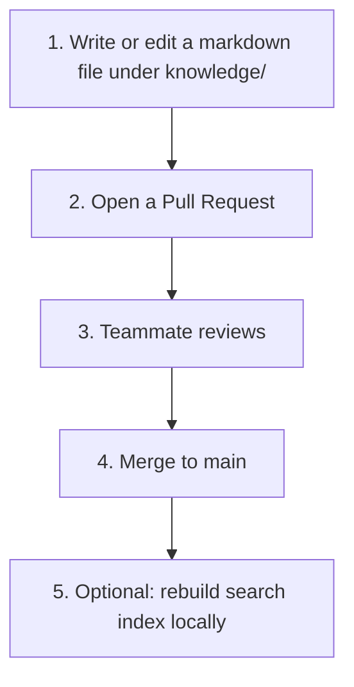

# How to use Groundline (simple guide)

**Audience:** Anyone on the team—**you do not need to be a programmer** to help with the knowledge in this repo. Technical setup is optional; **writing and reviewing clear notes** is the main job.

**Deep detail:** [REQUIREMENTS.md](REQUIREMENTS.md) • **Developers:** [Contributing](contributing.md) • **Leaders:** [LEADERSHIP_PITCH.md](LEADERSHIP_PITCH.md)

---

## 1. What Groundline is (in plain words)

Think of Groundline as a **shared notebook in git**:

- Important things the team agrees on live in **Markdown files** under **`knowledge/`** (not lost in chat or tickets).
- Changes go through a **Pull Request (PR)** so someone **reviews** before it becomes official on **`main`**.
- **Optional:** after install, a small program can **search** those notes and hand **relevant passages** to humans or AI tools so answers stay **grounded** in what the team actually merged.

---

## 2. What “good” looks like (for non-techies)

| You do | Why it helps |
|--------|----------------|
| **Write short, factual notes** when something important is decided or learned | The next person (or AI) can **find** it instead of guessing |
| **Put files in the right area** (`technical`, `delivery`, `testing`, `functional`, `meta`) | Keeps topics grouped so search stays useful |
| **Use `draft` in the front matter** until the PR is merged; the system can mark docs **`reviewed` after merge** | Shows what is still in progress vs officially part of the corpus |
| **Ask for a reviewer who knows the topic** | Catches mistakes early |

You **do not** have to run Python, servers, or AI tools to **contribute text**—that can be done in GitHub’s web editor or with help from a developer.

---

## 3. The team process (five steps)

1. **Write** — Add or change a `.md` file under the right `knowledge/...` folder. A small template sits at the top of each file (called **front matter**): title, area, `status`, etc.
2. **Pull Request** — Propose the change so others can see a **diff** and comment.
3. **Review** — At least one person checks facts, tone, and placement.
4. **Merge** — When merged to **`main`**, the note is part of the official corpus (and automation may set **`reviewed`** on drafts—see [Contributing](contributing.md)).
5. **Search (optional)** — People who installed the tooling can **refresh the index** and **ask questions** against merged notes—always citing **which file** the answer came from.

---

## 4. Roles at a glance

| Role | Typical focus |
|------|----------------|
| **PM / DM** | Product intent, scope, acceptance-style summaries under **`functional/`** or **`delivery/`** |
| **Developers** | How things are built, trade-offs, runbooks under **`technical/`** |
| **QE / testing** | How we validate, risks, regressions under **`testing/`** |
| **Anyone** | Small **`meta/`** notes about *how we use* this repo are fine if they help the team |

If unsure **where** a note goes, open a PR anyway and ask in the description—a reviewer can suggest a better path.

---

## 5. If you use an AI coding assistant

**Idea:** Let the assistant **read Groundline first**, then answer or edit code—so it uses **your** merged notes, not only generic training data.

- **Simple path:** Paste relevant excerpts from `knowledge/` into the chat (still cite the file path in your question).
- **Team setup (technical):** Someone runs the **local API** and optionally connects **MCP** so the assistant can call **search tools** automatically—see [MCP.md](MCP.md) and the [documentation home](index.md) / [README on GitHub](https://github.com/gyaneshgithub/TeamKM/blob/main/README.md).

**Rule of thumb:** Prefer **retrieve → then act** (search notes first, then change code or docs).

---

## 6. Words you might hear

| Term | Simple meaning |
|------|----------------|
| **Corpus** | All the approved markdown under `knowledge/` |
| **PR / Pull Request** | A proposed change others review before merge |
| **`main`** | The default branch—what counts as “current official” for the team |
| **Front matter** | The small YAML block at the top of a file with title, status, tags |
| **Index / RAG** | A **built** search layer over the corpus (optional for authors; useful for power users) |
| **MCP** | A standard way for **editors** to talk to small helper programs (optional) |

---

## 7. Where to go next

- **First contribution:** [Contributing](contributing.md) (branches, checks, what not to commit).
- **Why we built this:** [LEADERSHIP_PITCH.md](LEADERSHIP_PITCH.md).
- **Protecting the default branch:** [GITHUB_BRANCH_PROTECTION.md](GITHUB_BRANCH_PROTECTION.md).

---

## Revision

| Version | Date | Notes |
|---------|------|-------|
| 0.1 | 2025-11-06 | Initial simple “how to use” for mixed audiences |
