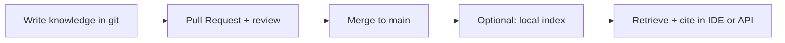

# Groundline

**Grounded context infrastructure for engineering teams.**

*Your team’s memory, in git—searchable on your machine.*

Groundline is a **template repository**: durable knowledge lives as **reviewed Markdown** under `knowledge/`, changes flow through **Pull Requests**, and an optional **local retrieval service** grounds assistants and humans in **what the team merged**—with citations, not chat memory.

---

## Who should use this?

| You are… | Start here | What you get |
|----------|------------|--------------|
| **Engineer / platform** | [For engineering](for-engineering.md) | Index, HTTP API, MCP, CI, CONTRIBUTING workflow |
| **Engineering or product leadership** | [For management](for-management.md) · [Adopting Groundline](ADOPTION_OVERVIEW.md) | Rollout, risks, policy, template adoption (§4.5) |
| **Hiring / portfolio viewers** | [Portfolio](PORTFOLIO.md) · [Demo](DEMO.md) | Problem, stack, live demo script |
| **Product / functional owner** | [For product](for-product.md) | Write intent and decisions in `knowledge/functional/` without running servers |
| **Quality / QE** | [For quality & QE](for-quality.md) | Testing corpus, golden queries, pre-merge gates |
| **Anyone writing docs** | [How to use Groundline](HOW_TO_USE_GROUNDLINE.md) | Plain-language PR loop and glossary |

---

## The idea in one loop

---

## Adopt the template

1. **Use this template** or fork on GitHub → point **`origin`** at **your org’s repo**.
2. Protect **`main`**: PR-only, required check **`test`** ([Branch protection](GITHUB_BRANCH_PROTECTION.md)).
3. Pilot one **area** (service or feature); grow `knowledge/` with the same discipline as code.

Canonical spec: [Requirements](REQUIREMENTS.md). Executive summary: [Leadership brief](LEADERSHIP_PITCH.md).

---

## Repository vs this site

- **This site** — navigation and role-based entry; builds from `docs/` on every push to `main`.
- **The repo** — source of truth: `knowledge/` corpus, `ki` tooling, CI, Cursor skills under `.cursor/skills/`.
